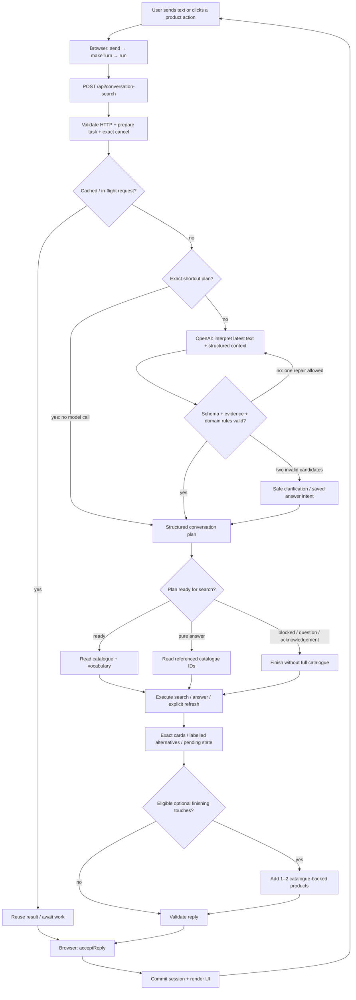
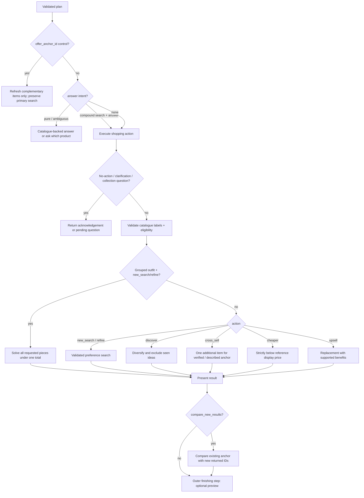
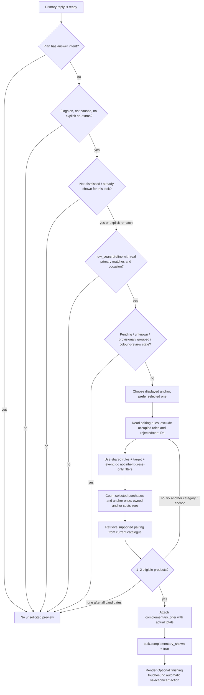
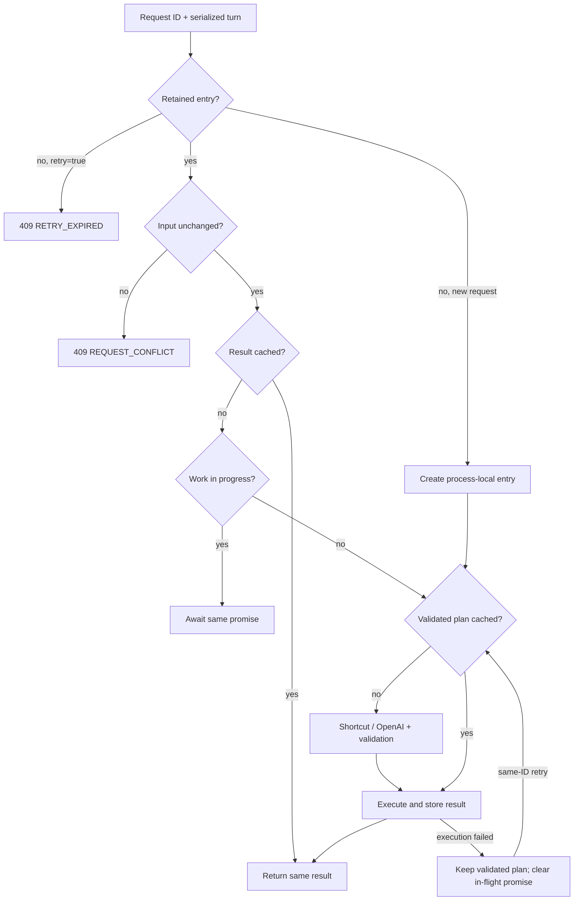

# AI Stylist: message flow and decision tree

Source snapshot: `main` at `2e283d2`, inspected 21 October 2026. This is a trace of the current code, not a proposed architecture. Line links refer to this snapshot and can shift after future edits.

Open the [interactive decision tree](/Users/salvi/.cursor/projects/Users-salvi-MQ-abc-fashion-ai-assistant/canvases/ai-stylist-message-flow.canvas.tsx) beside the chat. It has 104 searchable branches, source links, stage selection and expand/collapse controls. This document contains the diagrams, call tree, full branch descriptions and state model.

The most important distinction: **OpenAI interprets a message into a plan. Application code validates the plan, searches actual catalogue records, constructs the reply and decides whether to show optional products.** The normal flow does not ask a second model to invent product recommendations or write the final answer.

## Reading guide

- **AI**: the OpenAI interpretation call. A new request uses zero, one or at most two model interpretation attempts; exact shortcuts and cached requests can use none.
- **Rule**: deterministic TypeScript logic. It may normalize or reject an AI interpretation, pause for a question, compute a budget, rank products, or compose text.
- **Catalogue**: Supabase reads. Most shopping rules operate in memory after these reads.
- **Browser**: React state, user controls, rendering, offer memory and explicit cart actions.
- **Transport**: JSON/HTTP admission, timeouts, cancellation and process-local retry protection.
- `action` is the chosen operation; `status` is its outcome. `new_search` can result in `matches`, `alternatives`, `no_match` or `needs_clarification`. `answered` is a status, while `answer.kind` selects the question handler.
- Proactive `complementary_offer` is a separate optional reply field. It does not change a dress search into a `cross_sell` action. Explicitly asking for a matching bag does select `cross_sell`.

## 1. End-to-end diagram



The retry edge inside the AI block is bounded to **one repair**. After the second malformed plan, the application returns a safe clarification or preserves a pending answer; it does not loop indefinitely. An HTTP retry is a different mechanism shown below.

Stage entry points:

- [1. Browser: turn the user's message into a request](#stage-b001) — [components/stylist/ConversationChat.tsx:179](/Users/salvi/MQ/abc-fashion-ai-assistant/components/stylist/ConversationChat.tsx:179)
- [2. Server: admit the request and protect retries](#stage-b010) — [app/api/conversation-search/route.ts:19](/Users/salvi/MQ/abc-fashion-ai-assistant/app/api/conversation-search/route.ts:19)
- [3. Choose a plan: exact shortcut first, OpenAI otherwise](#stage-b016) — [app/api/conversation-search/route.ts:74](/Users/salvi/MQ/abc-fashion-ai-assistant/app/api/conversation-search/route.ts:74)
- [4. Validate and ground the proposed decision](#stage-b033) — [lib/stylist/conversationPlan.ts:99](/Users/salvi/MQ/abc-fashion-ai-assistant/lib/stylist/conversationPlan.ts:99)
- [5. Route by plan readiness and fetch the right data](#stage-b044) — [app/api/conversation-search/route.ts:80](/Users/salvi/MQ/abc-fashion-ai-assistant/app/api/conversation-search/route.ts:80)
- [6. Finish the turn and dispatch the action](#stage-b052) — [lib/stylist/conversationTurn.ts:281](/Users/salvi/MQ/abc-fashion-ai-assistant/lib/stylist/conversationTurn.ts:281)
- [7. Present primary results and preserve blockers](#stage-b076) — [lib/stylist/shoppingPresentation.ts:58](/Users/salvi/MQ/abc-fashion-ai-assistant/lib/stylist/shoppingPresentation.ts:58)
- [8. Add optional recommendations after the primary reply](#stage-b083) — [lib/stylist/conversationTurn.ts:299](/Users/salvi/MQ/abc-fashion-ai-assistant/lib/stylist/conversationTurn.ts:299)
- [9. Validate the reply, commit client state and render](#stage-b093) — [lib/stylist/conversationProtocol.ts:331](/Users/salvi/MQ/abc-fashion-ai-assistant/lib/stylist/conversationProtocol.ts:331)

## 2. Main call tree

Paths below are relative to `/Users/salvi/MQ/abc-fashion-ai-assistant/`. Every branch in the full atlas later has a clickable absolute source path and line number.

```text
User text / starter / suggestion / product action
└─ components/stylist/ConversationChat.tsx:179 send()
   ├─ lib/stylist/conversationProtocol.ts:298 makeTurn()
   └─ components/stylist/ConversationChat.tsx:117 run()
      └─ lib/ai/chatRequest.ts:20 postChatJson()
         └─ app/api/conversation-search/route.ts:19 POST()
            ├─ EnvelopeSchema / TurnSchema
            ├─ lib/stylist/taskState.ts:60 prepareConversationTask()
            ├─ lib/stylist/conversationTurn.ts:248 cancellationReply()
            └─ lib/stylist/conversationStore.ts:22 store.run()
               ├─ interpret callback
               │  ├─ conversationTurn.ts:21 interpreterInput()
               │  ├─ conversationTurn.ts:30 shortcutPlan()
               │  └─ if no shortcut: lib/ai/interpretConversation.ts:397
               │     └─ conversationPlan.ts:585 generateValidatedConversationPlan()
               │        ├─ OpenAI Responses structured plan
               │        ├─ conversationModelPlan.ts:27 decodeModelPlan()
               │        ├─ conversationGrounding.ts:31 groundRequirementEvidence()
               │        └─ conversationPlan.ts:99 checkConversationPlan()
               └─ execute callback
                  ├─ commerce flag gate
                  ├─ answer-only: targeted product IDs
                  ├─ not ready: empty catalogue, return question/acknowledgement
                  └─ ready: catalogue + vocabulary in parallel
                     └─ conversationTurn.ts:281 finishConversationTurn()
                        ├─ offer_anchor_id: refresh existing additions
                        └─ conversationTurn.ts:317 finishPreparedConversationTurn()
                           ├─ ground / validate again
                           ├─ combined-budget confirmation / discovery stage
                           ├─ answer / pending answer / resumed compound draft
                           └─ conversationSearch.ts:45 executeConversationSearch()
                              ├─ grouped outfit total solver
                              ├─ discover
                              ├─ cross_sell
                              ├─ cheaper
                              ├─ upsell
                              └─ ordinary new_search / refine
                           └─ shoppingPresentation.ts:58 presentShoppingResult()
                           └─ optional compare with new results / pending state
                        └─ proactiveCrossSell.ts:32 buildComplementaryOffer()
                        └─ TurnReplySchema
            └─ HTTP JSON response
      └─ conversationProtocol.ts:331 acceptReply()
         ├─ validate invariants before committing
         ├─ primary/complementary/focus/previous reference groups
         ├─ scopes + styling + task + bounded history
         └─ render cards / Your look / optional additions / recovery controls

Separate browser-only controls:
  Hide suggestions / No more extras → local offer memory (+ optional events)
  New chat                         → clear offer memory + remount chat
  Add to cart                      → ShoppingProductResults.tsx:87 add()
                                     → lib/cart.ts:79 addToCart()
```

The repeated `prepareConversationTask`, grounding, parsing and checking are real calls in the current code. They are deliberately not collapsed into a single imaginary validator in this map. They do not each invoke OpenAI.

## 3. Action and answer branches



The model's eight `action` values are `new_search`, `refine`, `cross_sell`, `cheaper`, `upsell`, `clarify`, `none` and `discover`. Their domain schema is [lib/stylist/conversationPlan.ts:72](/Users/salvi/MQ/abc-fashion-ai-assistant/lib/stylist/conversationPlan.ts:72). Product/policy/combination questions are additional `answer` intents, not additional action enum values.

A plan can combine a search action with an answer. If a required product reference is ambiguous, the application saves the intended search as `pending_answer.follow_up`, asks which product, and revalidates the original draft against its original message when the answer arrives.

## 4. Optional recommendation decision tree



The loops are finite: walk the available displayed anchors and recorded pairing categories, then return `null` if none qualify. The explicit refresh branch can bypass the already-shown check, but it does not bypass a paused/dismissed setting or the other eligibility rules. An exception in optional preview building is caught so it cannot invalidate the requested primary search.

Main references: [lib/stylist/conversationTurn.ts:281](/Users/salvi/MQ/abc-fashion-ai-assistant/lib/stylist/conversationTurn.ts:281), [lib/stylist/proactiveCrossSell.ts:32](/Users/salvi/MQ/abc-fashion-ai-assistant/lib/stylist/proactiveCrossSell.ts:32), [components/stylist/FinishingTouches.tsx:9](/Users/salvi/MQ/abc-fashion-ai-assistant/components/stylist/FinishingTouches.tsx:9).

## 5. Retry, duplicate and failure tree



- The browser's normal request deadline is 120 seconds. A single model API attempt has a 30-second timeout; there is no SDK automatic provider retry in this interpreter.
- The server retry store retains up to 100 entries for a 10-minute TTL within one process. A server restart or another instance may not have the request ID.
- Body/schema errors are 400, origin mismatch 403, oversized body 413, wrong content type 415, stale/conflicting/expired controls 409, catalogue-stage failures 503, other interpretation/execution failures 502.
- A technical database/provider error is not an empty-stock result. A valid search with insufficient stock can return `no_match`; a technical failure goes through the error response and retry UI.
- Clicking Cancel while a request loads aborts the client's HTTP request. Typing an exact `cancel` is a separate server branch that can restore a pending task snapshot.
- The browser checks controller identity and the aborted flag before accepting results; a late result from an abandoned request does not commit state.

## 6. What travels with a message

```text
request envelope
├─ request_id                     UUID; same ID used for an HTTP retry
├─ retry                          false for a fresh submission
└─ turn
   ├─ message                     latest raw user text, maximum 2,000 chars
   ├─ scopes
   │  ├─ item                     current item filters
   │  ├─ shared                   explicit cross-item restrictions
   │  ├─ unresolved_item          unknown local hard requirements
   │  └─ unresolved_shared        unknown global hard requirements
   ├─ context
   │  ├─ latest                   primary displayed matches + alternatives
   │  ├─ complementary            separate optional additions, up to two
   │  ├─ previous                 up to two previous primary groups
   │  ├─ focused                  product page / item just discussed
   │  ├─ comparison               remembered replacement reference
   │  └─ selected                 snapshots of saved look pieces, up to eight
   ├─ history                     latest six messages = three exchanges
   ├─ pending                     blocked shopping action + before-state
   ├─ pending_answer              question + optional saved follow-up search
   ├─ styling                     selected/owned pieces, owned descriptions,
   │                              excluded IDs, required features, priorities,
   │                              dress code, outfit request, purchase budget,
   │                              offers_paused and owned categories
   ├─ collection                  explicit choice, effective current choice,
   │                              optional collection checkpoint
   ├─ discovery                   stage, prior questions and seen product IDs
   ├─ task                        generation, repeated blocker, brief, issues,
   │                              provisional permission, shown/dismissed flags
   ├─ cart_product_ids            distinct existing cart IDs, maximum 50
   └─ browser controls (optional)
      ├─ shortcut                 clicked action + product ID
      ├─ preview_other_colours     one-turn explicit preview
      ├─ recovery                 operation + issue ID + task generation
      └─ offer_anchor_id          explicitly selected rematching anchor
```

The last four control fields are removed by `interpreterInput()`. The OpenAI context serialization also omits `cart_product_ids`; application retrieval still uses them to exclude existing cart items. The model receives product snapshots, not the full live catalogue or the Supabase credentials.

### Where memory lives

- React/page memory: messages, saved look, preferences, pending state and product references.
- Browser `sessionStorage`: only the optional-offer shown/dismissed/paused flags and task generation. It does not store conversation text or product IDs.
- Browser cart storage: separate from chat and New chat.
- Server process: request IDs, in-flight work, validated plan and cached result. This is retry protection, not an account conversation store.
- Supabase: catalogue, labels, sizes, categories, pairing rules, reviewed features and prototype specifications. Optional recommendation-event writes use a separate gated endpoint.

## 7. Example paths through the actual branches

1. **“Find a women's dress for a beach wedding under A$200.”** Browser packet → shortcut check (a normal rich request usually falls through) → OpenAI `new_search` plan → evidence/grounding → item/shared composition and collection resolution → catalogue/vocabulary → validated ordinary search → exact/alternative split → eligible optional additions → schema → accepted state and cards.
2. **“What material is the second dress made of?”** Resolve the primary ordinal through the plan/answer reference rules → targeted current-record read → deterministic material answer. Preserve search scopes and displayed ordering; the optional addition does not become the second dress.
3. **Click “Save to look.”** Explicit product shortcut → `none + styling_intent.outfit_changes[keep]` → known-context validation → update look → quiet acknowledgement. The cart Add handler is not called.
4. **“Now find a matching bag for [dress name].”** `cross_sell` → resolve and verify dress → fresh item scope for the bag → apply shared rules/remaining combined allowance → pairing retrieval → bag cards. An existing pause on unsolicited offers does not forbid this explicit request.
5. **Click “Match a different dress.”** Send `offer_anchor_id` → deterministic refine shortcut → route readiness/catalogue → outer refresh branch → rebuild extras only → `offer_refresh=true` → update the existing offer in place. Preserve primary results and scopes.
6. **“Find a dress and shoes under A$300 altogether.”** Ground all components and one total → `new_search + outfit_request` → grouped solver → one group per component, at most five choices per group → combined-price checks. Suppress a second unsolicited preview on this grouped response.
7. **Ask for verified waterproof shoes.** Preserve an unresolved hard requirement → clarification without retrieval. Explicit provisional permission retains the requirement and labels every resulting card; permission to preview does not erase the requirement.
8. **A catalogue query fails after a good plan.** Technical error → preserved browser state → Retry with the same request ID → cached validated plan → rerun catalogue/execution. This does not require another interpretation while the process-local plan entry survives.

## 8. Complete source-linked branch atlas

Expand the same branches interactively in the canvas. These source references identify branch entry points, not line ranges. A parent describes the phase; its children describe conditions or delegated functions.

<a id="stage-b001"></a>

### B001 · 1. Browser: turn the user's message into a request

**Browser** · [components/stylist/ConversationChat.tsx:179](/Users/salvi/MQ/abc-fashion-ai-assistant/components/stylist/ConversationChat.tsx:179)

send() is the entry for typed messages, starter chips, suggested replies and product actions. The browser owns the current conversation state.

The packet contains the latest text plus explicit state, rather than sending only a string.

#### B002 · Reject empty, oversized or overlapping sends

**Browser** · [components/stylist/ConversationChat.tsx:180](/Users/salvi/MQ/abc-fashion-ai-assistant/components/stylist/ConversationChat.tsx:180)

Trim the text. Ignore empty text, text over 2,000 characters, or another send while a request is busy.

#### B003 · Choose the product focus

**Browser** · [components/stylist/ConversationChat.tsx:182](/Users/salvi/MQ/abc-fashion-ai-assistant/components/stylist/ConversationChat.tsx:182)

A product button supplies its product snapshot; otherwise a newly viewed product page can supply focus when no search clarification is pending. An explicit colour preview suppresses focus.

#### B004 · Read cart IDs and assemble makeTurn()

**Browser** · [lib/stylist/conversationProtocol.ts:298](/Users/salvi/MQ/abc-fashion-ai-assistant/lib/stylist/conversationProtocol.ts:298)

Read distinct cart product IDs (maximum 50), preferences, selected/owned pieces, collection, discovery, pending questions, task state and product references.

An unfamiliar newly focused product resets item-local filters while preserving a compatible saved size. Shared restrictions remain.

Only the latest six history messages (three user/assistant exchanges) are included. This is separate from the structured state.

#### B005 · Create request envelope and display the user bubble

**Browser** · [components/stylist/ConversationChat.tsx:191](/Users/salvi/MQ/abc-fashion-ai-assistant/components/stylist/ConversationChat.tsx:191)

Create a fresh UUID request_id, retry=false and turn. Product keep/own/remove/reject operations can be quiet updates rather than chat bubbles.

#### B006 · POST JSON, with cancellation and timeout

**Transport** · [components/stylist/ConversationChat.tsx:117](/Users/salvi/MQ/abc-fashion-ai-assistant/components/stylist/ConversationChat.tsx:117)

run() owns an AbortController and calls postChatJson('/api/conversation-search', ...) with a 120-second client timeout. The HTTP helper maps network, HTTP, invalid JSON, timeout and cancellation failures.

##### B007 · HTTP helper

**Transport** · [lib/ai/chatRequest.ts:20](/Users/salvi/MQ/abc-fashion-ai-assistant/lib/ai/chatRequest.ts:20)

Serialize the envelope, send JSON, reject non-2xx responses, parse JSON, and detach the timer/abort listener on completion.

#### B008 · Product actions use the same conversation endpoint

**Browser** · [components/stylist/ConversationChat.tsx:205](/Users/salvi/MQ/abc-fashion-ai-assistant/components/stylist/ConversationChat.tsx:205)

cross_sell, cheaper, upsell, keep, own, reject and remove are converted to text plus a validated shortcut carrying the clicked product ID.

#### B009 · Two recommendation controls have different paths

**Browser** · [components/stylist/ConversationChat.tsx:219](/Users/salvi/MQ/abc-fashion-ai-assistant/components/stylist/ConversationChat.tsx:219)

Hide these suggestions / No more extras update local session state immediately; they do not request an AI interpretation. Optional telemetry is separate.

Match a different item sends a normal envelope with offer_anchor_id. That ID is removed from interpreterInput and handled by deterministic rules.

<a id="stage-b010"></a>

### B010 · 2. Server: admit the request and protect retries

**Transport** · [app/api/conversation-search/route.ts:19](/Users/salvi/MQ/abc-fashion-ai-assistant/app/api/conversation-search/route.ts:19)

The Node.js route is the current chat endpoint. All successful replies use Cache-Control: no-store.

#### B011 · Validate HTTP input

**Transport** · [app/api/conversation-search/route.ts:20](/Users/salvi/MQ/abc-fashion-ai-assistant/app/api/conversation-search/route.ts:20)

If present, Origin must match Host (403). Require application/json (415), limit body to 64,000 bytes (413), reject invalid JSON (400), and parse the envelope/turn schema (400). Legacy unwrapped turns receive a server-generated request ID.

#### B012 · Prepare task state before interpretation

**Rule** · [lib/stylist/taskState.ts:60](/Users/salvi/MQ/abc-fashion-ai-assistant/lib/stylist/taskState.ts:60)

With STYLIST_TASK_RECOVERY_ENABLED=false, return the input unchanged. Otherwise clone and normalize task state; the prepared_key makes repeated preparation of the same turn idempotent.

A replacement task increments generation, clears obsolete pending questions, local filters and offer flags, and preserves independent shared restrictions and saved pieces.

Reject stale recovery generation/issue IDs. Retain collection answers, confirmed colour choices, explicit provisional-browsing permission and the shopping brief.

#### B013 · Handle an exact typed cancel before the store or AI

**Rule** · [lib/stylist/conversationTurn.ts:248](/Users/salvi/MQ/abc-fashion-ai-assistant/lib/stylist/conversationTurn.ts:248)

Cancel a pending product question first; otherwise restore the pending shopping request's before_scopes and relevant state, or clear a collection checkpoint. This is distinct from aborting the browser's in-flight HTTP request.

#### B014 · Deduplicate requests and reuse validated plans

**Transport** · [lib/stylist/conversationStore.ts:22](/Users/salvi/MQ/abc-fashion-ai-assistant/lib/stylist/conversationStore.ts:22)

Same request ID with different serialized input: RequestConflictError. retry=true without a retained entry: RetryExpiredError.

A cached result returns immediately; a duplicate in-flight request awaits the same promise.

If interpretation succeeded but execution failed, a retry reuses the saved plan and runs execution again. Interpretation failures do not leave a saved plan.

The cache is process-local: 10-minute TTL, capacity 100. It is neither persistent chat storage nor a shared multi-server cache.

#### B015 · Map technical errors to HTTP responses

**Transport** · [app/api/conversation-search/route.ts:125](/Users/salvi/MQ/abc-fashion-ai-assistant/app/api/conversation-search/route.ts:125)

Expired/conflicting retry: 409 with RETRY_EXPIRED/REQUEST_CONFLICT. Failure while stage=catalogue: 503 CATALOGUE_UNAVAILABLE. Other interpretation/execution failures: 502 CONVERSATION_FAILED. Stale task recovery is an earlier 409 STALE_RECOVERY.

<a id="stage-b016"></a>

### B016 · 3. Choose a plan: exact shortcut first, OpenAI otherwise

**Rule** · [app/api/conversation-search/route.ts:74](/Users/salvi/MQ/abc-fashion-ai-assistant/app/api/conversation-search/route.ts:74)

The expression is shortcutPlan(turn) ?? await interpretConversation(input, signal). A shortcut still passes plan validation; bypassing the model does not bypass the application rules.

#### B017 · Strip browser controls from AI-facing input

**Rule** · [lib/stylist/conversationTurn.ts:21](/Users/salvi/MQ/abc-fashion-ai-assistant/lib/stylist/conversationTurn.ts:21)

interpreterInput removes shortcut, preview_other_colours, recovery and offer_anchor_id, then parses the conversation-plan request. Structured context remains.

#### B018 · Shortcut: refresh a complementary anchor

**Rule** · [lib/stylist/conversationTurn.ts:32](/Users/salvi/MQ/abc-fashion-ai-assistant/lib/stylist/conversationTurn.ts:32)

An explicit offer_anchor_id yields a refine plan with no changes. The outer finishing function later takes the special refresh branch.

#### B019 · Shortcut: narrowly defined confirmations

**Rule** · [lib/stylist/conversationTurn.ts:36](/Users/salvi/MQ/abc-fashion-ai-assistant/lib/stylist/conversationTurn.ts:36)

Exact provisional consent with unchanged filters, confirmed combined budget, and a confirmed colour choice can avoid OpenAI. Additional compound instructions fall through.

#### B020 · Shortcut: named combination total or compatibility

**Rule** · [lib/stylist/conversationTurn.ts:59](/Users/salvi/MQ/abc-fashion-ai-assistant/lib/stylist/conversationTurn.ts:59)

Up to four named products plus a total/combination question, without a shopping mutation, become action=none + answer.kind=combination.

#### B021 · Shortcut: recovery choices

**Rule** · [lib/stylist/conversationTurn.ts:70](/Users/salvi/MQ/abc-fashion-ai-assistant/lib/stylist/conversationTurn.ts:70)

A valid drop_requirement removes the identified unresolved label; preview_unverified refines with the label retained; restart_task uses none after task preparation.

#### B022 · Shortcut: simple matching set

**Rule** · [lib/stylist/conversationTurn.ts:79](/Users/salvi/MQ/abc-fashion-ai-assistant/lib/stylist/conversationTurn.ts:79)

A recognized complete matching-set grammar becomes new_search + outfit_request; groundConversationPlan supplies grounded normalized constraints.

#### B023 · Shortcut: answer a collection checkpoint

**Rule** · [lib/stylist/conversationTurn.ts:84](/Users/salvi/MQ/abc-fashion-ai-assistant/lib/stylist/conversationTurn.ts:84)

An exact Men/Women/Unisex/All choice becomes refine or discover with an item gender change. The browsing collection choice is separate from a global restriction.

#### B024 · Shortcut: discovery starter

**Rule** · [lib/stylist/conversationTurn.ts:102](/Users/salvi/MQ/abc-fashion-ai-assistant/lib/stylist/conversationTurn.ts:102)

Exact uncertainty / everyday / occasion / browse / different-ideas choices select discover with a discovery_intent; richer requests go to OpenAI.

#### B025 · Shortcut: outfit review or event refinement

**Rule** · [lib/stylist/conversationTurn.ts:122](/Users/salvi/MQ/abc-fashion-ai-assistant/lib/stylist/conversationTurn.ts:122)

A recognized outfit-review question becomes none + outfit_review. A dress-code message can refine an active grouped outfit.

#### B026 · Shortcut: other exact supported prompts

**Rule** · [lib/stylist/conversationTurn.ts:137](/Users/salvi/MQ/abc-fashion-ai-assistant/lib/stylist/conversationTurn.ts:137)

A complete browse-more grammar, an identifiable value comparison, removal of a described owned item, or an explicit colour-preview flag can select a deterministic plan.

#### B027 · Shortcut: disambiguate a pending product answer

**Rule** · [lib/stylist/conversationTurn.ts:168](/Users/salvi/MQ/abc-fashion-ai-assistant/lib/stylist/conversationTurn.ts:168)

An exact product name, ID, or first–fifth ordinal resumes the saved answer intent. Compound constraints do not use this narrow shortcut.

#### B028 · Shortcut: verified-feature or benefit response

**Rule** · [lib/stylist/conversationTurn.ts:185](/Users/salvi/MQ/abc-fashion-ai-assistant/lib/stylist/conversationTurn.ts:185)

Exact feature search/removal maps pockets, lining, adjustable strap, zip closure or machine wash care into styling requirements. A short answer to a prior replacement-benefit question can select upsell.

#### B029 · Shortcut: clicked product action

**Rule** · [lib/stylist/conversationTurn.ts:232](/Users/salvi/MQ/abc-fashion-ai-assistant/lib/stylist/conversationTurn.ts:232)

Reject IDs not present in known context. keep/own/remove/reject become none + outfit_changes; similar becomes refine; cross_sell/cheaper/upsell retain their action and explicit product ID.

#### B030 · No shortcut: interpret the message with OpenAI

**AI** · [lib/ai/interpretConversation.ts:397](/Users/salvi/MQ/abc-fashion-ai-assistant/lib/ai/interpretConversation.ts:397)

Requires OPENAI_API_KEY. OPENAI_CONVERSATION_MODEL defaults in this code snapshot to gpt-5.6-luna. One SDK call has a 30-second timeout and maxRetries=0.

Responses API structured output; store=false; low reasoning effort; 4,000 output tokens initially and 6,000 on a validation repair.

The system prompt is in this same file starting at line 14. Context is a separate user message; the raw latest customer text is the final user message.

The model receives scopes, product snapshots, six history messages, pending shopping/answer questions, styling, discovery, collection and task. This call does not receive the full catalogue, and the serialized context here omits cart_product_ids.

##### B031 · Decode the model transport shape

**Rule** · [lib/ai/conversationModelPlan.ts:27](/Users/salvi/MQ/abc-fashion-ai-assistant/lib/ai/conversationModelPlan.ts:27)

Each change has text_value, number_value and list_values slots. The decoder selects the correct slot for the field, rejects incompatible slots, normalizes scalar remove-null to set-null, then parses the domain plan.

##### B032 · Validate; repair once for malformed plans

**Rule** · [lib/stylist/conversationPlan.ts:585](/Users/salvi/MQ/abc-fashion-ai-assistant/lib/stylist/conversationPlan.ts:585)

At most two generated candidates. Retry only PlanValidationError (including evidence errors), Zod errors or invalid JSON. Give the second call field/rule feedback, not an unchecked product result.

Provider errors and cancellation are technical failures, not reasons to fabricate a clarification or automatically retry the provider.

After two invalid candidates: preserve a pending product-answer intent when one exists; otherwise return a fail-closed clarify plan with no preference changes or product selection.

<a id="stage-b033"></a>

### B033 · 4. Validate and ground the proposed decision

**Rule** · [lib/stylist/conversationPlan.ts:99](/Users/salvi/MQ/abc-fashion-ai-assistant/lib/stylist/conversationPlan.ts:99)

The same pure validation is deliberately called at multiple boundaries: model repair, route, turn finishing, and search execution. It is repeated rule evaluation, not repeated AI calls.

#### B034 · Validate quotation evidence before normalization

**Rule** · [lib/stylist/conversationPlan.ts:102](/Users/salvi/MQ/abc-fashion-ai-assistant/lib/stylist/conversationPlan.ts:102)

Every model change and styling quotation must occur in the latest message. Validate intent_evidence, outfit budget evidence, external-item descriptions and field/value types. A valid quote proves textual support, not that the entire semantic interpretation is correct.

#### B035 · Ground literal constraints and reference corrections

**Rule** · [lib/stylist/conversationGrounding.ts:56](/Users/salvi/MQ/abc-fashion-ai-assistant/lib/stylist/conversationGrounding.ts:56)

Normalize explicit event labels, category/garment families, colours, size and budget edits; correct known product references and saved-item addition requests.

Keep explicit shared rules separate from ordinary item preferences; preserve unknown requirements during a provisional preview; recognize explicit no-extras and owned-accessory statements.

Recover complete multi-piece totals, saved travel budgets and selected-piece additions. Reject ambiguous name/position references rather than choosing silently.

#### B036 · Check action and continuation semantics

**Rule** · [lib/stylist/conversationPlan.ts:133](/Users/salvi/MQ/abc-fashion-ai-assistant/lib/stylist/conversationPlan.ts:133)

Continuation must correspond to the pending shopping action. clarify needs a question. none cannot carry shopping filter changes or a top-level reference. Discovery cannot silently replace an active outfit.

#### B037 · Apply styling changes

**Rule** · [lib/stylist/conversationPlan.ts:214](/Users/salvi/MQ/abc-fashion-ai-assistant/lib/stylist/conversationPlan.ts:214)

Resolve keep/own/remove/reject references; maintain selected/owned pieces, rejected IDs, benefit priorities, required verified features, offer pause and described owned items. Ambiguity creates a styling question rather than a guessed selection.

#### B038 · Reset or retain item-local preferences

**Rule** · [lib/stylist/conversationPlan.ts:335](/Users/salvi/MQ/abc-fashion-ai-assistant/lib/stylist/conversationPlan.ts:335)

A non-continuing new_search or ordinary cross_sell resets the item scope and local unknowns. refine retains unmentioned restrictions. Category changes clear stale subcategory/type/size unless explicitly touched. Shared rules require explicit permission to weaken.

#### B039 · Resolve the clothing collection

**Rule** · [lib/stylist/conversationPlan.ts:411](/Users/salvi/MQ/abc-fashion-ai-assistant/lib/stylist/conversationPlan.ts:411)

Use explicit collection choices, saved browsing choice and supported Dresses/Skirts defaults. Unresolved clothing/discovery collection creates a checkpoint and a collection question, rather than requiring optional budget/size.

##### B040 · Collection defaults and explicit-language rules

**Rule** · [lib/stylist/collectionPreference.ts:82](/Users/salvi/MQ/abc-fashion-ai-assistant/lib/stylist/collectionPreference.ts:82)

Dresses and skirts can default to Women for a qualifying request. Other clothing families do not share that default. Explicit requests win; a conflicting shared restriction must still be resolved.

#### B041 · Compose item plus shared restrictions

**Rule** · [lib/stylist/preferenceScope.ts:102](/Users/salvi/MQ/abc-fashion-ai-assistant/lib/stylist/preferenceScope.ts:102)

Unresolved hard requirements block unless explicit provisional browsing is active. Shared scalar contradictions become typed shared_conflict issues.

Use the highest minimum price and lowest maximum price; intersect preferred colours; union exclusions. A preferred/excluded contradiction blocks.

Shared scope excludes category, subcategory, product_type and size: these cannot be universal cross-category preferences.

#### B042 · Resolve product references and return a decision status

**Rule** · [lib/stylist/conversationPlan.ts:498](/Users/salvi/MQ/abc-fashion-ai-assistant/lib/stylist/conversationPlan.ts:498)

Resolve IDs, names, positions, context references or a saved outfit anchor. Unknown/ambiguous identity blocks. Return no_action, needs_clarification or ready_for_validation with proposed scopes, resolved IDs, styling, collection and issues.

##### B043 · Reference namespaces

**Rule** · [lib/stylist/productReference.ts:113](/Users/salvi/MQ/abc-fashion-ai-assistant/lib/stylist/productReference.ts:113)

Primary latest results, separate complementary products, focus, previous result groups, comparison anchor and selected pieces support reference resolution. Unqualified ordinals remain primary; complementary products can be addressed by name or role.

<a id="stage-b044"></a>

### B044 · 5. Route by plan readiness and fetch the right data

**Rule** · [app/api/conversation-search/route.ts:80](/Users/salvi/MQ/abc-fashion-ai-assistant/app/api/conversation-search/route.ts:80)

The route decides whether to read selected product records, read the full catalogue plus vocabulary, or finish a blocked/no-action request without a catalogue search.

#### B045 · Commerce feature switch

**Rule** · [app/api/conversation-search/route.ts:82](/Users/salvi/MQ/abc-fashion-ai-assistant/app/api/conversation-search/route.ts:82)

STYLIST_COMMERCE_ENABLED=false returns a no_action reply for explicit cross_sell and upsell. The proactive planner also checks this switch.

#### B046 · Answer-only or ambiguous question path

**Rule** · [app/api/conversation-search/route.ts:88](/Users/salvi/MQ/abc-fashion-ai-assistant/app/api/conversation-search/route.ts:88)

Resolve answer product IDs and related pairing/comparison anchor IDs. Fetch at most 24 unique IDs with getCatalogueProductsByIds; policy, general guidance and ambiguous references may need no IDs. If an answer resumes a saved search, do not take this early path.

#### B047 · Blocked / no-action / discovery question path

**Rule** · [app/api/conversation-search/route.ts:104](/Users/salvi/MQ/abc-fashion-ai-assistant/app/api/conversation-search/route.ts:104)

If checkConversationPlan is not ready_for_validation and no pending answer resumes a search, call finishConversationTurn with empty catalogue/vocabulary. The UI receives the question or acknowledgement, not invented products.

#### B048 · Ready search path: parallel catalogue and vocabulary reads

**Catalogue** · [app/api/conversation-search/route.ts:110](/Users/salvi/MQ/abc-fashion-ai-assistant/app/api/conversation-search/route.ts:110)

Load getCatalogueProducts() and loadPreferenceValues() concurrently. Empty catalogue or database failure is technical failure, not an ordinary no_match.

##### B049 · Catalogue facts and availability

**Catalogue** · [lib/recommendations/catalogue.ts:24](/Users/salvi/MQ/abc-fashion-ai-assistant/lib/recommendations/catalogue.ts:24)

Read product_catalog in pages of 200, maximum 5,000 products, with a 15-second query signal. Include SKU, price, stock, availability, sizes, material, event/style labels, image keys and legacy cross-sell category.

##### B050 · Commercial catalogue enrichment

**Catalogue** · [lib/stylist/commerceCatalogue.ts:12](/Users/salvi/MQ/abc-fashion-ai-assistant/lib/stylist/commerceCatalogue.ts:12)

Batch 100 product IDs. Read verified stylist_product_features, cross_sell_rules joined to categories, and prototype_product_specifications with 10-second signals. Missing enrichment is represented separately from base catalogue availability.

##### B051 · Permitted catalogue vocabulary

**Catalogue** · [lib/catalogue/preferenceValues.ts:23](/Users/salvi/MQ/abc-fashion-ai-assistant/lib/catalogue/preferenceValues.ts:23)

Read product_catalog labels, sizes and categories in pages of 500 with a 15-second signal. Build normalized labels and category hierarchy; missing or incomplete reference data fails the request.

<a id="stage-b052"></a>

### B052 · 6. Finish the turn and dispatch the action

**Rule** · [lib/stylist/conversationTurn.ts:281](/Users/salvi/MQ/abc-fashion-ai-assistant/lib/stylist/conversationTurn.ts:281)

The outer finishConversationTurn owns special offer refresh and the later proactive preview. Its inner finishPreparedConversationTurn grounds the plan, handles questions/continuations, executes retrieval and builds the primary reply.

#### B053 · Budget confirmation / travel planning

**Rule** · [lib/stylist/conversationTurn.ts:325](/Users/salvi/MQ/abc-fashion-ai-assistant/lib/stylist/conversationTurn.ts:325)

For multiple named new pieces with a model total but no clear combined/per-item wording, ask whether the total is combined and save budget_confirmation. A saved travel-layer brief can ask for component choices before retrieval.

#### B054 · Resume a saved compound question

**Rule** · [lib/stylist/conversationTurn.ts:353](/Users/salvi/MQ/abc-fashion-ai-assistant/lib/stylist/conversationTurn.ts:353)

Resolve a product clarification, revalidate the saved draft against the original message, then apply the latest explicit edits. resumesAnswerSearch can restore a saved search+answer without losing its filters.

#### B055 · Discovery is a state machine

**Rule** · [lib/stylist/conversationTurn.ts:366](/Users/salvi/MQ/abc-fashion-ai-assistant/lib/stylist/conversationTurn.ts:366)

A collection/stage question returns no_action with suggested replies. A browsing stage proceeds to retrieval. Discovery is an action, not a separate AI model.

#### B056 · Product/policy/compare/outfit/combination answer

**Rule** · [lib/stylist/conversationTurn.ts:389](/Users/salvi/MQ/abc-fashion-ai-assistant/lib/stylist/conversationTurn.ts:389)

answer.kind is independent of action. Pure answers or ambiguous references return answered with no new shopping cards; ambiguous compound searches retain follow_up for later. Search-plus-answer plans can continue searching.

##### B057 · Resolve and assemble factual answers

**Rule** · [lib/stylist/conversationAnswers.ts:145](/Users/salvi/MQ/abc-fashion-ai-assistant/lib/stylist/conversationAnswers.ts:145)

Answer text is composed in application code from current records, published store copy and explicitly labelled prototype specifications. There is no second free-form LLM response writer here. Unknown facts remain unknown; changed product identity requires refresh.

##### B058 · Answer-intent schema

**Rule** · [lib/stylist/answerPlan.ts:6](/Users/salvi/MQ/abc-fashion-ai-assistant/lib/stylist/answerPlan.ts:6)

Kinds: product, compare, policy, outfit_review, guidance, combination. Topics include recommendation, material, fit, sizes, availability, price, care, quality, delivery, returns, payment, general and total_price. compare_new_results means search before comparing.

#### B059 · Search executor: eligibility and vocabulary guard

**Rule** · [lib/stylist/conversationSearch.ts:45](/Users/salvi/MQ/abc-fashion-ai-assistant/lib/stylist/conversationSearch.ts:45)

Exclude cart/rejected IDs; apply verified feature requirements, explicit provisional known-violation exclusions, shared context restrictions and relevant dress-code checks. Block invalid catalogue labels before shortlisting.

##### B060 · No action / clarification

**Rule** · [lib/stylist/conversationSearch.ts:135](/Users/salvi/MQ/abc-fashion-ai-assistant/lib/stylist/conversationSearch.ts:135)

Return the checked acknowledgement or blocker without products. A valid stylist operation can update Your look even when action=none.

##### B061 · Grouped outfit before ordinary action routing

**Rule** · [lib/stylist/conversationSearch.ts:174](/Users/salvi/MQ/abc-fashion-ai-assistant/lib/stylist/conversationSearch.ts:174)

When an active outfit_request accompanies new_search/refine, verify anchors and run the grouped total solver.

###### B062 · Combined-budget solver

**Rule** · [lib/search/outfitBudgetSearch.ts:11](/Users/salvi/MQ/abc-fashion-ai-assistant/lib/search/outfitBudgetSearch.ts:11)

Compose preferences for every component; enforce contextual compatibility; search all eligible candidates. Branch-and-bound finds a feasible set using integer cents. Add up to five alternatives per group only if the sum of group maxima fits the combined cap. Any displayed one-per-group combination remains affordable.

##### B063 · discover → diverse catalogue ideas

**Rule** · [lib/stylist/conversationSearch.ts:186](/Users/salvi/MQ/abc-fashion-ai-assistant/lib/stylist/conversationSearch.ts:186)

Search with allowUnanchored=true and diversify=true. Exclude previously seen ideas for a fresh batch, while retaining eligibility filters.

##### B064 · Verify live catalogue references before comparison or pairing

**Rule** · [lib/stylist/conversationSearch.ts:200](/Users/salvi/MQ/abc-fashion-ai-assistant/lib/stylist/conversationSearch.ts:200)

Referenced products must exist, be available/in stock and agree with remembered identity fields. Changed/missing references produce needs_clarification, not a comparison against a forged client snapshot.

##### B065 · cross_sell → one additional item

**Rule** · [lib/stylist/conversationSearch.ts:252](/Users/salvi/MQ/abc-fashion-ai-assistant/lib/stylist/conversationSearch.ts:252)

An external owned description needs a target category and uses description-based pairing. A catalogue pairing requires one resolved anchor. Verify saved pieces, account for a combined purchase allowance when present, and pass occupied roles and exclusions.

###### B066 · Pairing retrieval

**Rule** · [lib/search/crossSell.ts:63](/Users/salvi/MQ/abc-fashion-ai-assistant/lib/search/crossSell.ts:63)

Use an explicit requested target first; otherwise use recorded pairing categories. Resolve the target, reject duplicate item roles, filter before shortlisting, and score compatibility with catalogue/owned anchors. Outcomes include no_rule and rule_unavailable.

###### B067 · Remaining purchase budget

**Rule** · [lib/stylist/purchaseBudget.ts:19](/Users/salvi/MQ/abc-fashion-ai-assistant/lib/stylist/purchaseBudget.ts:19)

Use current prices for selected purchases; already-owned pieces do not consume new-purchase budget. Compute the remaining allowance for the one new item and verify every displayed purchase total.

##### B068 · cheaper → strictly lower-priced alternatives

**Rule** · [lib/stylist/conversationSearch.ts:341](/Users/salvi/MQ/abc-fashion-ai-assistant/lib/stylist/conversationSearch.ts:341)

Require consistent remembered display prices and verified live references. Search below the lowest referenced price while keeping the applicable saved limits.

###### B069 · Cheaper retrieval

**Rule** · [lib/search/cheaperSearch.ts:35](/Users/salvi/MQ/abc-fashion-ai-assistant/lib/search/cheaperSearch.ts:35)

Validate current versus displayed reference prices, retain hard constraints, exclude references and shortlist only strictly cheaper eligible products.

##### B070 · upsell → demonstrated replacement benefits

**Rule** · [lib/stylist/conversationSearch.ts:391](/Users/salvi/MQ/abc-fashion-ai-assistant/lib/stylist/conversationSearch.ts:391)

Require one verified anchor. Compare relevant construction/care benefits and trade-offs, respecting priorities and hard requirements. It is not an automatic premium-price pitch.

###### B071 · Replacement retrieval

**Rule** · [lib/search/upsell.ts:77](/Users/salvi/MQ/abc-fashion-ai-assistant/lib/search/upsell.ts:77)

Verify original identity, price and eligibility. Compare suitable replacements using recorded benefits; return no_upsell when an improvement cannot be supported.

##### B072 · new_search / refine → ordinary preference search

**Rule** · [lib/stylist/conversationSearch.ts:441](/Users/salvi/MQ/abc-fashion-ai-assistant/lib/stylist/conversationSearch.ts:441)

Use the composed, validated preferences and the eligibility predicate. Referenced refinement may infer a shared category/subcategory/type, never silently copy an anchor's price, colour, size or material.

###### B073 · Validate vocabulary, then retrieve

**Rule** · [lib/search/validatedPreferenceSearch.ts:11](/Users/salvi/MQ/abc-fashion-ai-assistant/lib/search/validatedPreferenceSearch.ts:11)

validatePreferences canonicalizes supported labels/families and reports blockers. Search only the validated result. Blocking label errors become needs_more_detail/needs_clarification.

###### B074 · Hard filters, then contextual ranking

**Rule** · [lib/search/preferenceSearch.ts:118](/Users/salvi/MQ/abc-fashion-ai-assistant/lib/search/preferenceSearch.ts:118)

Filter validity/stock, price, size, collection, category, subcategory, family/type, brand, material and colours. Score item-local occasion=4, style=3, fit=2, season=1. Prefer contextual matches when any exist; then tie-break by collection, stock, price and SKU. Default shortlist size is five; discovery can diversify.

#### B075 · Search first, then compare the returned IDs

**Rule** · [lib/stylist/conversationTurn.ts:412](/Users/salvi/MQ/abc-fashion-ai-assistant/lib/stylist/conversationTurn.ts:412)

For compare_new_results, compare up to three newly returned products with the saved anchor after retrieval, rather than asking for references to results that did not exist yet.

<a id="stage-b076"></a>

### B076 · 7. Present primary results and preserve blockers

**Rule** · [lib/stylist/shoppingPresentation.ts:58](/Users/salvi/MQ/abc-fashion-ai-assistant/lib/stylist/shoppingPresentation.ts:58)

The presenter transforms retrieval output into exact cards, labelled alternatives and human-readable wording. Product descriptions and prices come from the catalogue, not invented model products.

#### B077 · Decorate cards / grouped outfits

**Rule** · [lib/stylist/shoppingPresentation.ts:75](/Users/salvi/MQ/abc-fashion-ai-assistant/lib/stylist/shoppingPresentation.ts:75)

Add local image endpoints, product explanations, supported extra_target and unknown-requirement labels. Grouped outfit results preserve their own component/budget structure.

#### B078 · Explicit other-colour preview

**Rule** · [lib/stylist/shoppingPresentation.ts:130](/Users/salvi/MQ/abc-fashion-ai-assistant/lib/stylist/shoppingPresentation.ts:130)

Only an explicit preview flag can search outside the saved preferred colour. Shared colour rules or unresolved requirements block this preview. Saved scopes are unchanged; differences are labelled.

#### B079 · Split exact, context-difference and provisional cards

**Rule** · [lib/stylist/shoppingPresentation.ts:152](/Users/salvi/MQ/abc-fashion-ai-assistant/lib/stylist/shoppingPresentation.ts:152)

Individual item-local occasion/style/fit/season differences become alternatives; shared context violations are removed. A provisional preview retains unknown labels on every card. The presenter can change partial retrieval into matches or alternatives.

#### B080 · Construct message and optional question

**Rule** · [lib/stylist/shoppingPresentation.ts:179](/Users/salvi/MQ/abc-fashion-ai-assistant/lib/stylist/shoppingPresentation.ts:179)

Build matches/no_match/alternatives/clarification/no_upsell wording, then friendlyShoppingMessage. Clothing without an occasion may get one optional occasion question after showing results; this is not a prerequisite for browsing.

#### B081 · Save pending search or answer state

**Rule** · [lib/stylist/conversationTurn.ts:424](/Users/salvi/MQ/abc-fashion-ai-assistant/lib/stylist/conversationTurn.ts:424)

Store the original goal, reference and pre-change snapshots when a shopping question blocks. Keep pending_answer separate so a policy/product question does not overwrite the shopping task. Track repeated typed blockers and expose recovery choices.

#### B082 · Attach deterministic explanations and totals

**Rule** · [lib/stylist/conversationTurn.ts:436](/Users/salvi/MQ/abc-fashion-ai-assistant/lib/stylist/conversationTurn.ts:436)

Acknowledge valid look changes, return safe no-action guidance, preserve misunderstood state, disclose described-item limitations, append purchase allowance/deadline constraints and combine any answer with the shopping response.

<a id="stage-b083"></a>

### B083 · 8. Add optional recommendations after the primary reply

**Rule** · [lib/stylist/conversationTurn.ts:299](/Users/salvi/MQ/abc-fashion-ai-assistant/lib/stylist/conversationTurn.ts:299)

A proactive complementary preview is a post-processing step. It is not a ninth AI action, not another OpenAI call, and not an automatic selection or cart mutation.

#### B084 · Do not attach previews to answer-intent turns

**Rule** · [lib/stylist/conversationTurn.ts:302](/Users/salvi/MQ/abc-fashion-ai-assistant/lib/stylist/conversationTurn.ts:302)

An explicit resume-offers intent clears shown/dismissed memory when the pause is actually lifted. Otherwise buildComplementaryOffer only runs when the interpreted plan has no answer intent.

#### B085 · Gate the preview

**Rule** · [lib/stylist/proactiveCrossSell.ts:32](/Users/salvi/MQ/abc-fashion-ai-assistant/lib/stylist/proactiveCrossSell.ts:32)

Both feature switches must allow it; no paused/offered-dismissed/no-extras state, and no already-shown preview for this task unless explicitly rematching.

Require primary new_search/refine results with status matches/partial and a known occasion.

Suppress for pending questions, unknown requirements, provisional results, grouped outfit budgets and other-colour previews.

#### B086 · Pick a displayed anchor and available role

**Rule** · [lib/stylist/proactiveCrossSell.ts:42](/Users/salvi/MQ/abc-fashion-ai-assistant/lib/stylist/proactiveCrossSell.ts:42)

Prefer a displayed selected item, otherwise walk displayed primary matches. Exclude owned/selected/described roles, rejected/cart IDs, primary result IDs and already chosen additions. Iterate recorded pairing categories.

#### B087 · Keep addition preferences separate from dress filters

**Rule** · [lib/stylist/proactiveCrossSell.ts:70](/Users/salvi/MQ/abc-fashion-ai-assistant/lib/stylist/proactiveCrossSell.ts:70)

Start with empty item preferences plus shared rules, the target role, and applicable collection/occasion. Do not copy dress-only size, colour, material or price cap.

#### B088 · Fit additions within a true combined purchase limit

**Rule** · [lib/stylist/proactiveCrossSell.ts:55](/Users/salvi/MQ/abc-fashion-ai-assistant/lib/stylist/proactiveCrossSell.ts:55)

Price the example/selected anchor once plus selected purchases; an owned anchor costs no new money. Where a purchase budget exists, cap each addition by the remaining allowance after earlier additions.

#### B089 · Require supported pairing evidence; return at most two

**Rule** · [lib/stylist/proactiveCrossSell.ts:78](/Users/salvi/MQ/abc-fashion-ai-assistant/lib/stylist/proactiveCrossSell.ts:78)

Reuse retrieveCrossSell against the already loaded catalogue. Accept catalogue_supported evidence with a real record and applied preferences. Accumulate actual prices; return one anchor and up to two items, or null.

#### B090 · Remember that an offer was shown; optional failure stays optional

**Rule** · [lib/stylist/conversationTurn.ts:306](/Users/salvi/MQ/abc-fashion-ai-assistant/lib/stylist/conversationTurn.ts:306)

Set task.complementary_shown only for a real offer; append the offer sentence and validate the reply. An optional preview exception is caught so valid requested primary results still return.

#### B091 · Special branch: rematch rather than run a new search

**Rule** · [lib/stylist/conversationTurn.ts:286](/Users/salvi/MQ/abc-fashion-ai-assistant/lib/stylist/conversationTurn.ts:286)

With offer_anchor_id, revalidate that displayed anchor and its saved preferences, rebuild additions, and return offer_refresh=true with action=none, status=no_action and no primary cards. Scopes and styling are preserved.

##### B092 · Validate the refresh source

**Rule** · [lib/stylist/proactiveCrossSell.ts:104](/Users/salvi/MQ/abc-fashion-ai-assistant/lib/stylist/proactiveCrossSell.ts:104)

The ID must be in current primary latest results, no question may be pending, preferences must compose, and the anchor must still pass the saved search.

<a id="stage-b093"></a>

### B093 · 9. Validate the reply, commit client state and render

**Browser** · [lib/stylist/conversationProtocol.ts:331](/Users/salvi/MQ/abc-fashion-ai-assistant/lib/stylist/conversationProtocol.ts:331)

The browser commits the state only after acceptReply validates the response contract against the exact submitted turn.

#### B094 · Server and client reply invariants

**Rule** · [lib/stylist/conversationProtocol.ts:77](/Users/salvi/MQ/abc-fashion-ai-assistant/lib/stylist/conversationProtocol.ts:77)

Enforce action/status/card consistency, safe product images, price/size/colour constraints, budgets, unique product IDs, pairing evidence and complementary totals. Reply status describes the outcome, not the chosen AI action.

#### B095 · Reject unintended state changes

**Rule** · [lib/stylist/conversationProtocol.ts:331](/Users/salvi/MQ/abc-fashion-ai-assistant/lib/stylist/conversationProtocol.ts:331)

Rematching must use the requested anchor and preserve scopes/styling. An unclear intent cannot change saved preferences. Pure answers preserve scopes and pending search; provisional/colour alternatives require explicit permission.

#### B096 · Maintain separate reference groups

**Rule** · [lib/stylist/conversationProtocol.ts:348](/Users/salvi/MQ/abc-fashion-ai-assistant/lib/stylist/conversationProtocol.ts:348)

Successful new results replace latest and retain two previous groups. Pure answers, blockers and empty results preserve latest. Complementary items have their own group; a single-product answer can set focus without reordering primary results.

#### B097 · Commit the next session and bounded history

**Browser** · [lib/stylist/conversationProtocol.ts:390](/Users/salvi/MQ/abc-fashion-ai-assistant/lib/stylist/conversationProtocol.ts:390)

Keep reply scopes, pending/pending_answer, styling, collection, discovery and task. Cart IDs remain those of the submitted turn. Append understood dialogue only, retaining six history messages.

#### B098 · Choose visible UI update

**Browser** · [components/stylist/ConversationChat.tsx:130](/Users/salvi/MQ/abc-fashion-ai-assistant/components/stylist/ConversationChat.tsx:130)

Commit validated state. Refresh an existing offer in place for offer_refresh; use a quiet status for a valid look-only update; otherwise append an assistant reply. Stale or aborted responses never commit.

#### B099 · Render current request, Your look, cards and controls

**Browser** · [components/stylist/ConversationChat.tsx:263](/Users/salvi/MQ/abc-fashion-ai-assistant/components/stylist/ConversationChat.tsx:263)

Render ShoppingRequestSummary, OutfitSummary, normal or grouped products, FinishingTouches, typed issue recovery, optional questions and suggested replies. Pending/busy state disables inappropriate actions.

##### B100 · Complementary UI

**Browser** · [components/stylist/FinishingTouches.tsx:9](/Users/salvi/MQ/abc-fashion-ai-assistant/components/stylist/FinishingTouches.tsx:9)

Show anchor, separate/combined pricing, actual product cards, rematch selector, Hide these suggestions and No more extras.

##### B101 · Cart changes are a separate explicit click

**Browser** · [components/stylist/ShoppingProductResults.tsx:87](/Users/salvi/MQ/abc-fashion-ai-assistant/components/stylist/ShoppingProductResults.tsx:87)

The product card Add to cart handler requires a valid selected size and calls addToCart in the browser. Chat interpretation, showing extras and Save to look do not call this handler.

#### B102 · Retry / cancellation UI

**Browser** · [components/stylist/ConversationChat.tsx:158](/Users/salvi/MQ/abc-fashion-ai-assistant/components/stylist/ConversationChat.tsx:158)

On technical failures, preserve current state. Retry reuses request_id and sets retry=true; invalid/expired requests are not retried automatically. Cancel aborts locally; controller identity checks prevent a late response from overwriting the next request.

#### B103 · Memory across close, reload and New chat

**Browser** · [lib/stylist/offerMemory.ts:12](/Users/salvi/MQ/abc-fashion-ai-assistant/lib/stylist/offerMemory.ts:12)

Conversation and saved look are page-memory state; closing the modal preserves them. sessionStorage retains only offer generation/shown/dismissed/paused flags across reload in the tab. New chat clears those flags and remounts the chat. Cart storage remains separate.

#### B104 · Optional analytics and diagnostics

**Browser** · [lib/stylist/recommendationTelemetry.ts:6](/Users/salvi/MQ/abc-fashion-ai-assistant/lib/stylist/recommendationTelemetry.ts:6)

Impression/selection/ownership/rejection/cart/offer events use /api/stylist-events; only STYLIST_ANALYTICS_ENABLED=true permits database writes. Diagnostics are separately gated. Neither telemetry nor diagnostics chooses products or commits chat state.

## 9. File index

- [app/api/conversation-search/route.ts](/Users/salvi/MQ/abc-fashion-ai-assistant/app/api/conversation-search/route.ts:19) — B010 at line 19; B011 at line 20; B015 at line 125; B016 at line 74; B044 at line 80; B045 at line 82; B046 at line 88; B047 at line 104; B048 at line 110
- [components/stylist/ConversationChat.tsx](/Users/salvi/MQ/abc-fashion-ai-assistant/components/stylist/ConversationChat.tsx:117) — B001 at line 179; B002 at line 180; B003 at line 182; B005 at line 191; B006 at line 117; B008 at line 205; B009 at line 219; B098 at line 130; B099 at line 263; B102 at line 158
- [components/stylist/FinishingTouches.tsx](/Users/salvi/MQ/abc-fashion-ai-assistant/components/stylist/FinishingTouches.tsx:9) — B100 at line 9
- [components/stylist/ShoppingProductResults.tsx](/Users/salvi/MQ/abc-fashion-ai-assistant/components/stylist/ShoppingProductResults.tsx:87) — B101 at line 87
- [lib/ai/chatRequest.ts](/Users/salvi/MQ/abc-fashion-ai-assistant/lib/ai/chatRequest.ts:20) — B007 at line 20
- [lib/ai/conversationModelPlan.ts](/Users/salvi/MQ/abc-fashion-ai-assistant/lib/ai/conversationModelPlan.ts:27) — B031 at line 27
- [lib/ai/interpretConversation.ts](/Users/salvi/MQ/abc-fashion-ai-assistant/lib/ai/interpretConversation.ts:397) — B030 at line 397
- [lib/catalogue/preferenceValues.ts](/Users/salvi/MQ/abc-fashion-ai-assistant/lib/catalogue/preferenceValues.ts:23) — B051 at line 23
- [lib/recommendations/catalogue.ts](/Users/salvi/MQ/abc-fashion-ai-assistant/lib/recommendations/catalogue.ts:24) — B049 at line 24
- [lib/search/cheaperSearch.ts](/Users/salvi/MQ/abc-fashion-ai-assistant/lib/search/cheaperSearch.ts:35) — B069 at line 35
- [lib/search/crossSell.ts](/Users/salvi/MQ/abc-fashion-ai-assistant/lib/search/crossSell.ts:63) — B066 at line 63
- [lib/search/outfitBudgetSearch.ts](/Users/salvi/MQ/abc-fashion-ai-assistant/lib/search/outfitBudgetSearch.ts:11) — B062 at line 11
- [lib/search/preferenceSearch.ts](/Users/salvi/MQ/abc-fashion-ai-assistant/lib/search/preferenceSearch.ts:118) — B074 at line 118
- [lib/search/upsell.ts](/Users/salvi/MQ/abc-fashion-ai-assistant/lib/search/upsell.ts:77) — B071 at line 77
- [lib/search/validatedPreferenceSearch.ts](/Users/salvi/MQ/abc-fashion-ai-assistant/lib/search/validatedPreferenceSearch.ts:11) — B073 at line 11
- [lib/stylist/answerPlan.ts](/Users/salvi/MQ/abc-fashion-ai-assistant/lib/stylist/answerPlan.ts:6) — B058 at line 6
- [lib/stylist/collectionPreference.ts](/Users/salvi/MQ/abc-fashion-ai-assistant/lib/stylist/collectionPreference.ts:82) — B040 at line 82
- [lib/stylist/commerceCatalogue.ts](/Users/salvi/MQ/abc-fashion-ai-assistant/lib/stylist/commerceCatalogue.ts:12) — B050 at line 12
- [lib/stylist/conversationAnswers.ts](/Users/salvi/MQ/abc-fashion-ai-assistant/lib/stylist/conversationAnswers.ts:145) — B057 at line 145
- [lib/stylist/conversationGrounding.ts](/Users/salvi/MQ/abc-fashion-ai-assistant/lib/stylist/conversationGrounding.ts:56) — B035 at line 56
- [lib/stylist/conversationPlan.ts](/Users/salvi/MQ/abc-fashion-ai-assistant/lib/stylist/conversationPlan.ts:99) — B032 at line 585; B033 at line 99; B034 at line 102; B036 at line 133; B037 at line 214; B038 at line 335; B039 at line 411; B042 at line 498
- [lib/stylist/conversationProtocol.ts](/Users/salvi/MQ/abc-fashion-ai-assistant/lib/stylist/conversationProtocol.ts:77) — B004 at line 298; B093 at line 331; B094 at line 77; B095 at line 331; B096 at line 348; B097 at line 390
- [lib/stylist/conversationSearch.ts](/Users/salvi/MQ/abc-fashion-ai-assistant/lib/stylist/conversationSearch.ts:45) — B059 at line 45; B060 at line 135; B061 at line 174; B063 at line 186; B064 at line 200; B065 at line 252; B068 at line 341; B070 at line 391; B072 at line 441
- [lib/stylist/conversationStore.ts](/Users/salvi/MQ/abc-fashion-ai-assistant/lib/stylist/conversationStore.ts:22) — B014 at line 22
- [lib/stylist/conversationTurn.ts](/Users/salvi/MQ/abc-fashion-ai-assistant/lib/stylist/conversationTurn.ts:21) — B013 at line 248; B017 at line 21; B018 at line 32; B019 at line 36; B020 at line 59; B021 at line 70; B022 at line 79; B023 at line 84; B024 at line 102; B025 at line 122; B026 at line 137; B027 at line 168; B028 at line 185; B029 at line 232; B052 at line 281; B053 at line 325; B054 at line 353; B055 at line 366; B056 at line 389; B075 at line 412; B081 at line 424; B082 at line 436; B083 at line 299; B084 at line 302; B090 at line 306; B091 at line 286
- [lib/stylist/offerMemory.ts](/Users/salvi/MQ/abc-fashion-ai-assistant/lib/stylist/offerMemory.ts:12) — B103 at line 12
- [lib/stylist/preferenceScope.ts](/Users/salvi/MQ/abc-fashion-ai-assistant/lib/stylist/preferenceScope.ts:102) — B041 at line 102
- [lib/stylist/proactiveCrossSell.ts](/Users/salvi/MQ/abc-fashion-ai-assistant/lib/stylist/proactiveCrossSell.ts:32) — B085 at line 32; B086 at line 42; B087 at line 70; B088 at line 55; B089 at line 78; B092 at line 104
- [lib/stylist/productReference.ts](/Users/salvi/MQ/abc-fashion-ai-assistant/lib/stylist/productReference.ts:113) — B043 at line 113
- [lib/stylist/purchaseBudget.ts](/Users/salvi/MQ/abc-fashion-ai-assistant/lib/stylist/purchaseBudget.ts:19) — B067 at line 19
- [lib/stylist/recommendationTelemetry.ts](/Users/salvi/MQ/abc-fashion-ai-assistant/lib/stylist/recommendationTelemetry.ts:6) — B104 at line 6
- [lib/stylist/shoppingPresentation.ts](/Users/salvi/MQ/abc-fashion-ai-assistant/lib/stylist/shoppingPresentation.ts:58) — B076 at line 58; B077 at line 75; B078 at line 130; B079 at line 152; B080 at line 179
- [lib/stylist/taskState.ts](/Users/salvi/MQ/abc-fashion-ai-assistant/lib/stylist/taskState.ts:60) — B012 at line 60

## 10. Final reply statuses and typed blockers

These values are the response outcomes in [TurnReplySchema](/Users/salvi/MQ/abc-fashion-ai-assistant/lib/stylist/conversationProtocol.ts:95), not additional AI actions:

- `matches`: primary product cards are present.
- `partial`: primary cards are present but the internal search reports incomplete contextual matching; presentation may normalize this into exact cards and labelled alternatives.
- `alternatives`: labelled alternatives are available rather than exact primary matches.
- `no_match`: a valid retrieval produced no qualifying result under the retained requirements.
- `needs_clarification`: a detail, conflict, unsupported requirement or product reference blocks proceeding.
- `answered`: an informational answer with no new shopping cards; it can also carry a saved question about which product was intended.
- `no_action`: acknowledgement, a look-only change, a discovery/collection stage question, or the special offer-refresh response. It is not automatically an error.
- `no_upsell`: no replacement benefit could be established.
- `no_rule`: no applicable additional-item category was available.
- `rule_unavailable`: the target category/rule cannot be resolved or applied.
- `primary_unavailable`: the reference product cannot currently be verified.
- `primary_mismatch`: the reference no longer passes the current comparison requirements.

[ConversationIssueSchema](/Users/salvi/MQ/abc-fashion-ai-assistant/lib/stylist/conversationIssues.ts:3) distinguishes `invalid_preference`, `shared_conflict`, `unverified_requirement`, `ambiguous_reference`, `stale_product`, `interpretation_failed` and `needs_detail`. An issue carries its field, item/shared/task scope, requested value, saved value and available options. The server can therefore return a specific recovery choice rather than only a generic text question. A recovery control identifies the exact issue and task generation; stale controls are rejected before interpretation.

## Scope and limits of this map

This traces the current `ConversationChat → /api/conversation-search` path. Older extraction, standalone recommendation, cross-sell and upsell endpoints can still exist in the repository; they are not extra mandatory hops in this current chat flow. For example, [the extraction endpoint](/Users/salvi/MQ/abc-fashion-ai-assistant/app/api/extraction/route.ts:36) uses `resolveFollowUp` and `extractPreferences`, [the standalone recommendations endpoint](/Users/salvi/MQ/abc-fashion-ai-assistant/app/api/recommendations/route.ts:169) calls `extractPreferences`, and [the older stylist-search endpoint](/Users/salvi/MQ/abc-fashion-ai-assistant/app/api/stylist-search/route.ts:82) calls `generateRecommendation`. The current conversation route does not invoke those endpoints as steps in this pipeline. Product-image HTTP requests and optional event submissions are side requests triggered by rendering/interactions, not additional AI decisions.

This was built by reading the source at the recorded commit, not by sending a live customer message. Repeated validation is observable in the code; it does not prove that every semantic AI interpretation is correct. For example, a quoted phrase can pass evidence validation while the model still infers an inappropriate pause or unknown requirement. The deterministic preview gates then operate on that resulting state.

