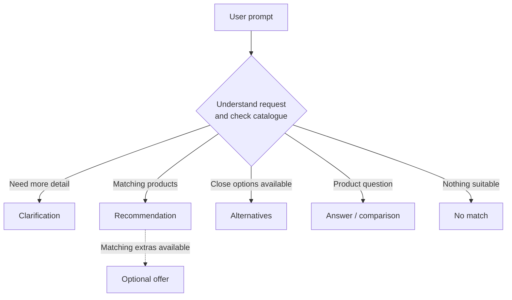

# AI Stylist: presentation overview

An optional offer can accompany a recommendation.

**271 if statements**

- **112** Intent & constraint grounding
- **95** Plan & state validation
- **38** Supported request recognition
- **26** Preferences, references & task context

[Counting method and sources](./ai-stylist-decision-count.md)

[Presentation diagram](./ai-stylist-presentation.svg)

