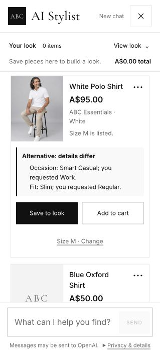

# Adaptive live reliability test — six shopping scenarios

**22 October 2026, Australia/Sydney.** Product facts were well grounded in this run, but the agent was unreliable at understanding shopping roles, recovering from ordinary ambiguity and helping a customer who was ready to decide.

Two scenarios reached their main goal with friction, three were partial, and the father-gift scenario failed. These are qualitative outcomes from one adaptive run, not a statistical reliability estimate.

## Method and limits

- Tested the running local app at `http://127.0.0.1:3003` with the configured real model, `gpt-5.6-luna`, and live Supabase catalogue. No mocked model, replay or synthetic test catalogue was used.
- S6 was performed directly through the customer browser. S1–S5 used independent live HTTP sessions with the same `makeTurn` / `acceptReply` protocol used by the customer interface. Those five sessions test conversation behavior and structured recommendations, not visual rendering.
- Each customer follow-up was chosen only after inspecting that scenario's preceding response. The reasons for each choice are preserved with the evidence. There was no prewritten follow-up dialogue.
- Applied the stricter interpretation of the cap: **12 total messages per scenario, counting both sides**. S1–S5 each used six exchanges / 12 messages. S6 reached its goal at four exchanges / eight messages. Total: 34 exchanges / 68 messages.
- The first navy-shirt probe became S6 once the fresh catalogue audit confirmed there was no exact match. Its interpretation failure is retained, not discarded. A known available blouse was used to make S1 a valid test of a satisfiable clear intention.
- Read the live catalogue independently: 318 records, 316 marked available. Stored the snapshot and source hashes. No catalogue, policy or application source was changed. Existing workspace edits were preserved.
- No purchase was attempted. The published help page states that checkout, payment and order placement are unavailable in this prototype.

[Complete S1–S5 conversations and adaptive reasons](transcripts.md) · [Complete S6 browser conversation](S6-transcript.md) · [Environment and source hashes](environment.json) · [Catalogue snapshot](catalogue-audit.json) · [Verification results](verification.json)

## Scenario outcomes

### 1. Clear intent — partial, 12 messages

**Brief:** Women's silver cotton blouse for work, size 12, regular fit, under A$180.

The first response immediately found Silver Blouse, P1259, A$170. Its recorded material, fit, occasion, colour and size range match the request. No unnecessary clarification was asked. An optional A$165 pair of White Loafers was grounded in Work and Minimalist styling. The blouse limit was treated as an item limit; the optional combined example was A$335, not a claim that both products cost under A$180.

The next reply correctly distinguished listed sizes from verified fit and individual-size stock. Care and measurement details were labelled synthetic. However, it required the customer to ask for that useful information rather than supplying the main material and fit explanation proactively.

The conversation then failed at readiness to decide:

- “How do I complete the purchase?” received a generic payment-method disclaimer.
- Asking explicitly whether checkout was available in the browsing prototype produced the identical disclaimer.
- Asking where to select size 12 and save the blouse to the bag produced an irrelevant specifications disclaimer and a sample garment length.
- Asking for the product link produced the same specifications answer, without a link.

The product recommendation succeeded; purchase preparation did not. The final “no other products” request did pause extras in the saved state.

### 2. Vague work intention — partial, 12 messages

**Opening:** “Something nice for work that doesn't look too formal.”

Asking which collection was sensible. Asking the occasion next was repetitive: Work was already in the saved preferences. After the customer restated the office setting, the agent showed a manageable range, led by a A$195 Burgundy Cardigan. It did not establish essential fit or spending limit through focused questions; the customer had to volunteer regular fit, size 12 and A$180.

The important role error occurred when the customer requested a top to wear with **trousers already owned**. The agent searched Bottoms and recommended skirts and trousers. After an explicit correction, it recovered to two appropriate tops: Silver Blouse, A$170, and Pink Satin Camisole, A$55. Alternative occasion differences were disclosed. Optional loafers were catalogue-supported, and the later “already have shoes / no more extras” request paused offers.

The final explanation was overly literal: it treated “my office” as an unconfirmed occasion despite Work being saved and recorded on the blouse. It correctly avoided claiming visual compatibility with undescribed owned trousers, but failed to give a useful practical reason for the office choice.

### 3. Browsing and discovery — goal reached with friction, 12 messages

**Opening:** Browsing ahead of a birthday dinner, with no settled product, style or budget.

The collection question was useful. The occasion question repeated information already volunteered, including the dinner mentioned again in the collection answer. Once restated as a casual restaurant dinner, the agent supplied five varied ideas without forcing a size or budget and without a pressured upsell.

Reacting to the actual Sage Platform Sandals led the customer to discover a preference for relaxed flat shoes and an A$110 limit. The agent unnecessarily asked which product was meant, even though the customer had named the sage sandals; the structured reference used “second” within a filtered Sandals subset. Providing the exact name and displayed position recovered the conversation.

The next shortlist contained five flat-sandal alternatives at A$55–A$90, with occasion and style differences explicitly labelled. The customer narrowed to Blue Flat Sandals, P1173, A$75. The agent accurately listed size 7 among the catalogue sizes and labelled its 0 cm heel specification as synthetic, without guaranteeing personal fit. Clearer preferences and a usable next step were achieved; no purchase was required.

### 4. Gift for father — failed, 12 messages

**Opening:** Birthday gift for Dad, up to A$90, clothing size unknown.

The agent asked about collection and everyday versus occasion use. It did not meaningfully tailor discovery to the recipient. When the customer explained that Dad walks to cafes, likes blues and greys, dislikes jewellery and needs something that avoids clothing-size uncertainty, the agent converted “easier to fit” and “dislikes jewellery” into unverifiable product requirements.

Three successive recovery attempts followed the agent's instructions:

1. Remove the fit wording, choose scarves, and exclude jewellery.
2. Remove the literal jewellery blocker while shopping only scarves.
3. Remove the generic Scarf product-type filter and use the Scarves subcategory.

The agent first repeated the jewellery blocker, then rejected the ordinary word “Scarf” because only specific catalogue product types were accepted, and finally returned an interpretation failure. It showed **zero products** across all six exchanges.

This was not a catalogue shortage. The independent snapshot contains Blue Lightweight Scarf, P1264, A$25, Unisex, Casual, One Size: it fits the stated colour, everyday use and total budget. Grey Lightweight Scarf, P1205, A$80, Unisex, One Size, is another plausible option with a disclosed Travel occasion tradeoff.

No age stereotype or fabricated size was observed, but the agent never reached a gift recommendation, optional addition or gift-specific policy discussion. Those checks remain unexercised rather than passed.

### 5. Preferences change — partial, 12 messages

**Opening:** Women's beach-wedding shirt, size 10, regular fit, under A$110, colour open.

Initial choices were Black Linen Shirt, A$95, and Brown Linen Shirt, A$40, with a Beige Linen Shirt alternative and an optional shoe pairing. After seeing them, the customer remembered a linen-blend sensitivity, required cotton and lowered the shirt budget to A$80.

The agent correctly retained size, regular fit and beach wedding, applied Cotton and A$80, and returned Brown Linen Shirt. Despite its product name, this product's recorded material is Cotton. When challenged, the agent accurately described that record and explicitly said it did not verify full composition or certification. This is a catalogue naming inconsistency, not an invented material claim. For a sensitivity, the supplier's composition still needs verification before a confident purchase recommendation.

The customer then rejected the brown shirt. The agent saved P1209 as rejected, gave an honest no-match and did not recycle it. Raising only the shirt limit to A$110 produced Beige Linen Shirt, P1210, A$100, cotton, regular fit, size 10 listed, with its Brunch versus Beach Wedding compromise disclosed. The earlier linen-blend Black Linen Shirt stayed out of results.

The final optional-bag request exposed another routing problem. The customer explicitly asked whether the A$100 beige shirt plus a bag could fit **A$110 altogether**. The response was a generic no-match. Its structured search category was Clothing rather than Bags, and neither the combined purchase-budget field nor task total captured A$110. No bag was shown, so there was no observed overspend; the result cannot establish that the remaining A$10 was correctly calculated or that complementary requests preserve the intended task.

Core preference updating and rejected-product memory worked. Complementary follow-through did not pass.

### 6. No suitable match — goal reached with friction, eight messages

**Brief:** Navy men's work shirt, M, regular fit, maximum A$100.

The first wording produced an interpretation failure. A simpler restatement produced an honest no-match, confirmed independently against the catalogue. The agent proposed relaxing colour and asked before changing it. The customer accepted any colour while retaining fit, size, occasion and price.

There was still no exact match. The browser clearly labelled three real alternatives and their additional compromises:

- White Polo Shirt, P1308, A$95: Slim fit; Smart Casual occasion.
- Blue Oxford Shirt, P1098, A$50: Oversized fit; Formal occasion.
- Yellow Oversized Shirt, P1013, A$95: recorded Slim fit; Formal occasion.

Each listed M and stayed within A$100. The agent did not present these as exact matches or invent stock guarantees or discounts. Colour relaxation alone was not enough; the further compromises were visible on the cards. The goal of honest limitation handling and verified alternatives was reached after avoidable initial friction.

## Grounding and response checks

The 30 HTTP requests all returned HTTP 200 and were accepted by the real customer conversation protocol. This is transport and schema success, not proof of a useful answer: the failed gift conversation also returned valid HTTP 200 replies.

The evidence verifier completed 80 checks without a factual or protocol mismatch. It checked 34 HTTP product-card occurrences, including optional items, against the live catalogue and separately verified all three browser alternatives. Product IDs, displayed names, prices, size labels and returned styling fields matched the snapshot; checked products were marked available with positive aggregate stock. That does **not** establish individual-size availability or garment fit.

The recorded cotton update, retained size/fit/occasion, rejected-product memory and disclosed beige-shirt tradeoff were independently checked. No returned item exceeded its applicable saved item cap. The optional examples had separately disclosed prices; they were not miscounted as purchases within a blouse-only cap. The last S5 combined-budget request remains a semantic failure despite its safe empty result.

Measured HTTP latency: median 8.94 seconds, 95th percentile 17.50 seconds, slowest 27.57 seconds. These are 30 observed local endpoint calls, including one deterministic 21 ms discovery response; browser-only latency was not measured. Concurrent independent scenarios and local development mode limit performance generalization.

## Fix priorities supported by this run

1. **Handle readiness and store navigation directly.** Return a verified product link, explain size selection and bag steps, and state that checkout is unavailable. The published behavior exists in [Shopping help](/Users/salvi/MQ/abc-fashion-ai-assistant/app/help/page.tsx:74). Current payment and general-product fallback behavior is visible in [conversation answers](/Users/salvi/MQ/abc-fashion-ai-assistant/lib/stylist/conversationAnswers.ts:43) and [the general-answer branch](/Users/salvi/MQ/abc-fashion-ai-assistant/lib/stylist/conversationAnswers.ts:128). S1 exchanges 3–6 are direct reproductions.
2. **Treat recipient tastes and exclusions as shopping context.** “Dislikes jewellery” should exclude jewellery rather than become a manufacturer-verifiable feature. Normalize generic category words such as scarf to the relevant catalogue family. The observed blockers flow through [issue messages](/Users/salvi/MQ/abc-fashion-ai-assistant/lib/stylist/conversationIssues.ts:33). The precise extraction and normalization changes need implementation and retesting; this run did not alter them.
3. **Keep owned items, requested items and complementary items distinct.** S2 exchange 4 searched owned trousers instead of the requested top. S5 exchange 6 searched Clothing instead of the requested bag and did not record the total budget. Both need focused live reproductions after a fix, including a real affordable complementary match so empty results cannot mask a budget error.
4. **Make discovery use volunteered information and resolve references consistently.** Work and birthday dinner should not be asked again after collection selection. [Discovery progression](/Users/salvi/MQ/abc-fashion-ai-assistant/lib/stylist/discovery.ts:21) presents a generic occasion question. S3 also exposes a displayed-position versus filtered-position mismatch in product reference handling; [reference resolution](/Users/salvi/MQ/abc-fashion-ai-assistant/lib/stylist/productReference.ts:159) is a relevant inspection point, not a proven sole cause.
5. **Normalize ordinary occasion language and flag contradictory catalogue names.** “My office” should use saved Work context. Cotton-labelled “Linen Shirt” and Slim-fit “Oversized Shirt” records deserve data review and clear qualification when the distinction matters.

No fixes or regression reruns were mixed into this assessment. The evidence represents the existing running implementation, including its pre-existing local UI edits.
