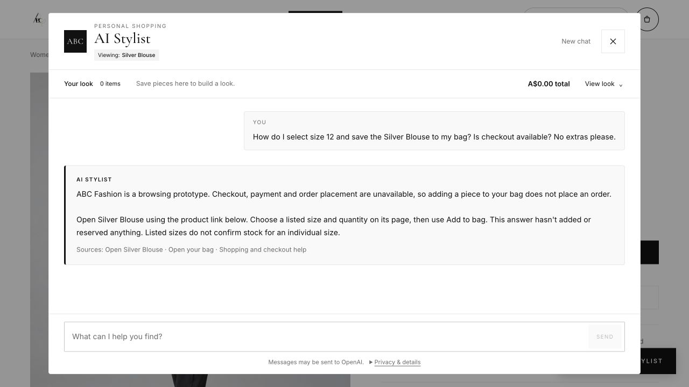

# Shopping-agent reliability fixes and retest

22 October 2026, Australia/Sydney. Implemented the five fix priorities in the [original adaptive report](../adaptive-browser-2026-10-22/report.md), plus the related interpretation and budget failures exposed while retesting.

The final production probes correctly handled an example shirt plus an affordable bag within one total, a father's gift budget and recipient preferences, and purchase-navigation guidance in the browser. All 28 new focused regression cases and all 46 offline regression scripts passed. These are targeted checks; this work does not establish a statistical reliability rate or a clean, repeated pass of all six live scenarios.

## Changes

- **Purchase readiness:** Product links, size-selection steps, bag navigation and checkout questions have a dedicated answer path. It resolves a known product, supplies only allowed product/bag/help links, and states that checkout, payment and orders are unavailable. It does not select products or mutate the bag. Mixed search requests continue through interpretation, and “no extras” still pauses offers.
- **Recipient context:** The shopping brief stores recipient, size uncertainty, category exclusions and volunteered occasion. Ordinary context such as “dislikes jewellery” is no longer an unverifiable product feature. Physical requirements such as composition, softness and construction remain subject to verification. Discovery asks about the recipient without inferring a collection or size from “Dad.”
- **Wanted versus owned versus example items:** An owned pair of trousers does not replace the requested top. A named shirt used as an example can anchor one new bag request without becoming a selected purchase or an invented outfit request.
- **Budgets:** Whole-purchase wording, including a later increase to a combined total, is retained. Current catalogue prices for selected and example purchases are subtracted before searching for the addition. Main gift/discovery results and optional additions respect the total even when the interpreter omits an item price cap. The response protocol validates the arithmetic and requires examples to belong to the conversation.
- **Conversation memory and discovery:** Literal garment, colour, material and fit requirements supplement incomplete model output. Trailing “find the best match” wording cannot erase a brief. The recipient's plural colour preferences are retained; two-colour alternatives are supported. Previously rejected products stay excluded. Already supplied occasions skip redundant discovery questions.
- **References and honest alternatives:** Unique descriptions such as “the sage flats” can identify an actual displayed product; ambiguous descriptions still ask for clarification. Filtered ordinals remain distinct from global positions. Generic scarf/top families are supported. “Neutral” asks a focused shade question. “My office” uses Work context. Name-versus-material/fit contradictions are surfaced without rewriting catalogue data or asserting supplier verification.
- **Optional recommendations:** Exclusions and gift colours also apply to optional items. Unknown recipient sizing prevents size-dependent optional purchases. A saved total constrains the main purchase plus optional additions together.

The UI budget label now distinguishes selected purchases from examples. The pre-existing removal of the shopping-request summary in `ConversationChat.tsx` was preserved.

## Verification

- **28/28 focused cases:** [test-adaptive-reliability-fixes.mjs](../../../scripts/test-adaptive-reliability-fixes.mjs). These exercise the full conversation domain using controlled interpreter plans, including deliberately incomplete or incorrect plans, and validate returned replies and accepted sessions.
- **46/46 offline scripts:** [complete regression output](../../test-evidence/regression-2026-10-21T23-07-59-822Z.txt). The new suite is included in the normal regression runner.
- **Type check, lint and whitespace checks:** passed without errors or lint warnings.
- **Production build:** `npm run build -- --webpack` passed. [Build output](build-webpack.txt). The default Turbopack build failed because its worker could not bind a port in the execution environment (OS error 1); the documented Webpack fallback compiled successfully. [Default build output](build-turbopack.txt).
- **Live evidence verification:** [102 checks passed](verification.json), including 54 product-card occurrences checked against the [318-product catalogue snapshot](catalogue-audit.json). Checks cover displayed facts and protocol acceptance for all successful recorded HTTP replies, plus explicitly named behavioral checks on the recovered/final turns. They do not treat earlier semantic failures as successes. Listed sizes and aggregate availability do not establish individual-size stock or personal fit.

## Adaptive live retest

Follow-ups were chosen after reading each response, with a maximum of six exchanges / 12 total messages per conversation ID. The configured real model and live catalogue were used. These conversations span implementation iterations; source was improved between probes. Initial failures and their adaptive reasons are retained in the [complete transcripts](transcripts.md) and original `*-live.json` files.

### Clear purchase intention — S1 and browser

The complete silver cotton blouse brief returned Silver Blouse P1259 at A$170 with recorded fit, material and work suitability. The next turn supplied the product, bag and help links and stopped extras. Two exchanges.

The final production browser check used the actual product page context. It visibly returned the correct **Add to bag** instructions, verified links and prototype checkout boundary, while the saved look remained empty. The earlier browser evidence still contains the intermediate “Add to cart” wording; this final capture supersedes it.

[Final browser accessibility evidence](browser-production-navigation.txt) · [Earlier exact-product browser evidence](browser-final-product.txt)

### Vague work intention — S2

After choosing the women's collection, the agent immediately offered work ideas instead of repeating the occasion question. When the customer supplied regular fit, size 12, a A$180 budget and owned trousers, it correctly searched Tops and returned Silver Blouse and Pink Satin Camisole. The final explanation connected “my office” to the blouse's recorded Work occasion and retained the owned-garment uncertainty. Four exchanges.

### Browsing — S3

The customer reacted to a dinner shortlist, then discovered a preference for neutral flat shoes under A$110. An intermediate revision mishandled a short “sage flats” reference and neutral colour direction; subsequent changes added unique descriptive references and a focused neutral-shade question. The conversation recovered to Cream Loafers A$105 and Grey Loafers A$90, followed by accurate listed-size and material information. Six exchanges. This was a recovered result, not a clean initial pass. The final reference and clarification behavior is covered by focused regression cases.

### Father's gift — S4, P3 and P4

The gift conversation progressed past the original jewellery and generic-scarf blockers, reached Blue Lightweight Scarf P1264 at A$25, and qualified sizing, delivery and exchange information. Intermediate probes exposed omitted recipient colours, a size-dependent optional item, and a separate gift-discovery budget omission. Those failures led to literal colour grounding, one-size-only optional eligibility for unknown sizing, and a server-enforced total cap.

The fresh **final production P4 probe** supplied the recipient's blue/grey preferences, dislike of jewellery, unknown clothing size and **A$90 total** in one natural brief. It returned five actual blue/grey ideas at A$25–A$80, with no jewellery, no automatic Clothing filter and no optional purchase. Unknown size remained saved; discovery offered a one-size direction instead of promising clothing fit. One successful exchange, preceded by a retained connection failure before a reply was received.

### Changing preferences and combined budget — S5 / P1

The first S5 interpretation failure was retained; P1 restarted with the same intended brief after fixing polite garment language. Cotton, regular fit, size 10 and the occasion persisted through price changes. The rejected brown shirt stayed rejected. Contradictory “Linen Shirt” names were qualified against the recorded Cotton material without claiming verified full composition.

At A$110 altogether, the A$100 beige example shirt correctly left **A$10 for a bag** and produced an honest no-match. An intermediate “raise the combined total to A$140” probe incorrectly tried rebuilding an outfit; combined-total wording and named-example routing were then corrected and regression-tested.

The **final production P1 exchange** returned Gold Mini Tote P1298 at **A$35**, with its compatibility compromise disclosed. The budget was **A$100 example + A$35 bag = A$135**, within A$140. The reply showed A$40 remaining for the addition, an empty selected outfit, no new outfit request and the brown shirt still rejected. Six exchanges for P1.

### No exact catalogue match — S6 / P2

The initial failure on a trailing “find the best match” phrase was retained; after correction, P2 immediately returned an honest no-match for a navy men's regular-fit work shirt, M, A$100 maximum. Accepting other colours produced three real A$50–A$95 alternatives with fit/occasion compromises and the requested size label visible. No exact-match claim or invented discount was used. Two exchanges.

## Remaining limits

The model can still vary, and the six scenarios were not repeated as a frozen-build reliability study. Final production HTTP probes were P1 exchange 6 and P4 exchange 2, plus the final browser check; earlier probes ran against successive development revisions. A transport failure and unsuccessful intermediate interpretations remain in the evidence.

Supplier composition, garment measurements, individual-size stock, delivery estimates and unspecified exchange terms remain unavailable. The fixes retain these boundaries instead of inventing facts. Catalogue records and the existing policy facts were not changed. No order was placed.

Source hashes used for this verification are stored in [verification.json](verification.json).
